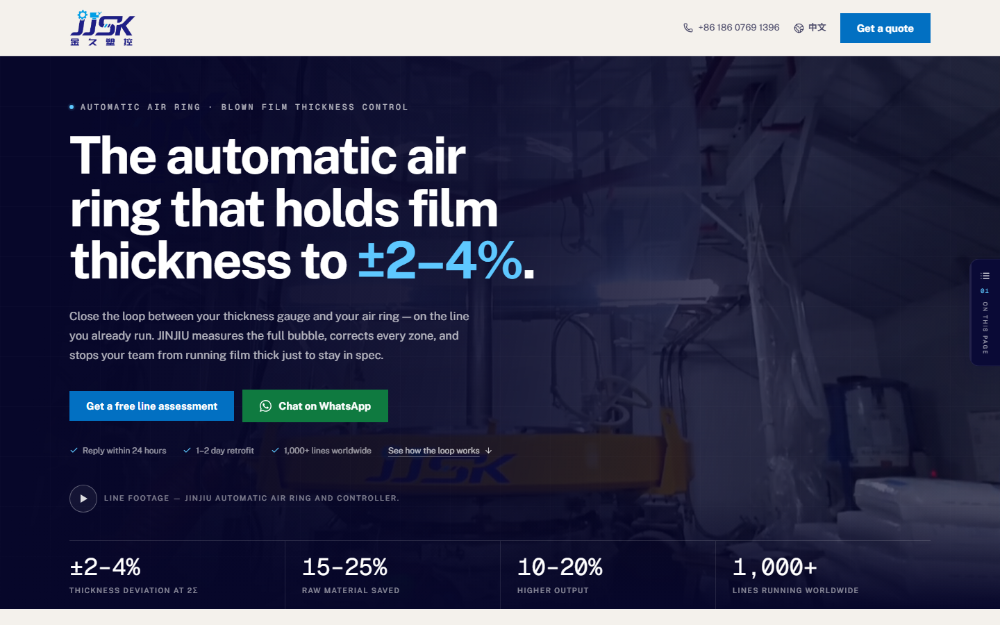
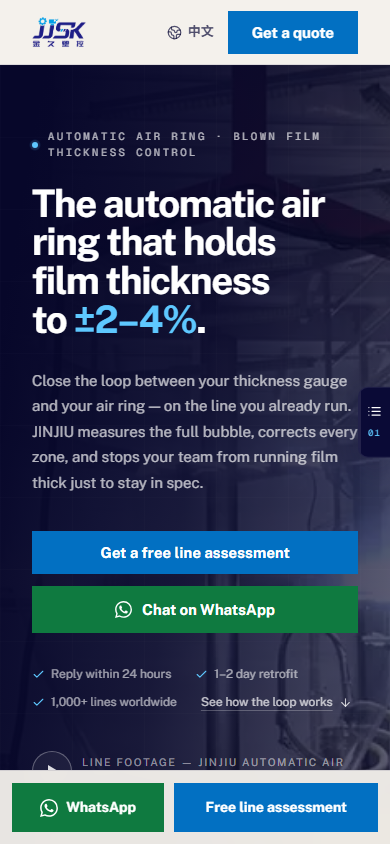
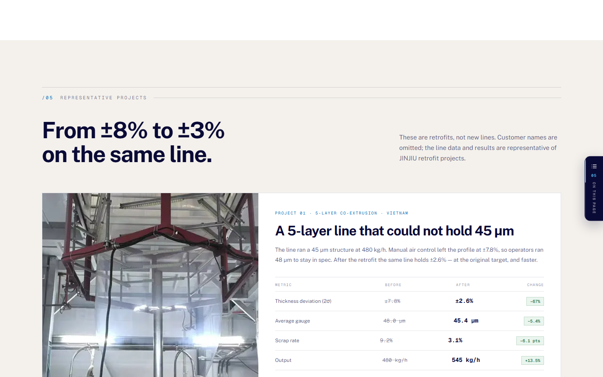
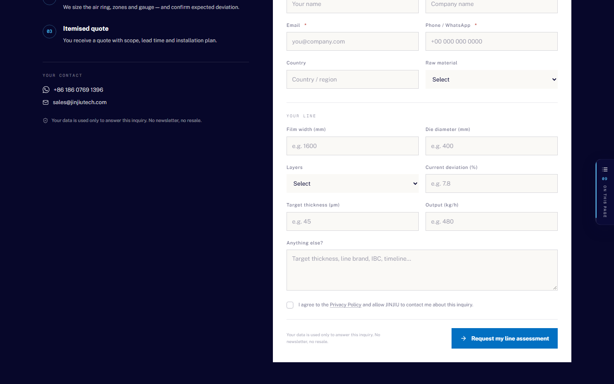
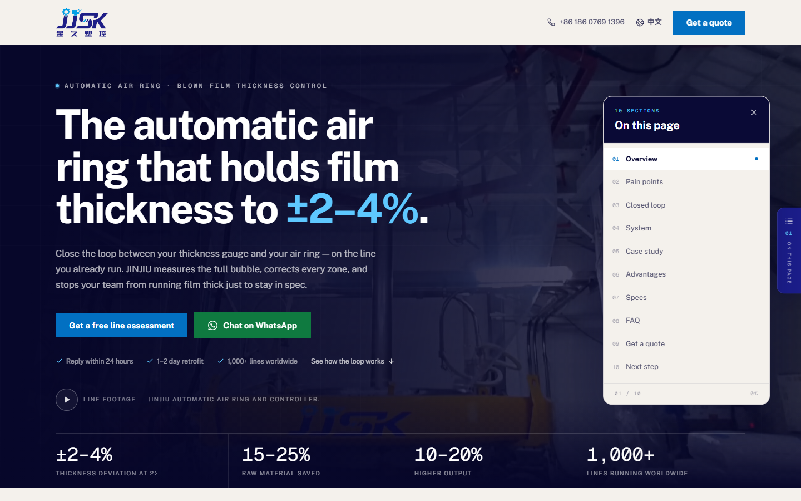
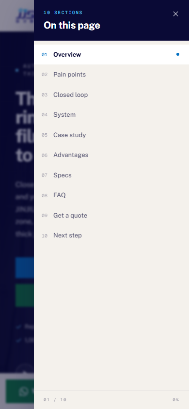

# Google Ads 落地页（自动风环）

## 0. 页面预览

| 桌面首屏 | 移动首屏 |
| --- | --- |
|  |  |

| 案例区 | 询盘表单 |
| --- | --- |
|  |  |

| 侧边目录（桌面） | 侧边目录（移动） |
| --- | --- |
|  |  |

## 1. 页面地址

| 语言 | URL |
| --- | --- |
| 英文（广告主推，无前缀） | `https://jinjiutech.com/lp/automatic-air-ring` |
| 中文 | `https://jinjiutech.com/zh/lp/automatic-air-ring` |

- 站点以英语为主：`/` 就是英文首页，英语页面一律不带 `/en`；其他语言才带前缀。
- 旧链接 `/en/...` 会由 `next.config.ts` 以 308 永久重定向到去掉 `/en` 的地址。
- 路由文件：`app/[locale]/(landing)/lp/automatic-air-ring/page.tsx`
- 只发布 `en` / `zh`；其他语言访问该路径返回 404（由 `(landing)/layout.tsx` 控制）。
- 页面使用独立外壳，**不显示**全站导航、悬浮客服和全站页脚，避免广告点击从导航流失。
- 页面设为 `noindex, follow`：它用于投放转化，不参与自然搜索排名，避免与首页/产品页抢同一批关键词。

## 2. 页面结构（对应 10 个区块）

| # | 区块 | 组件 |
| --- | --- | --- |
| 01 | Hero：定位、运行视频、主 CTA、数据条 | `components/landing/Hero.tsx` |
| 02 | 生产痛点：厚度偏差 / 人工调节 / 原料浪费 | `PainPoints.tsx` |
| 03 | 闭环原理：测厚仪 → 控制器 → 自动风环 + 对比曲线 | `LoopSection.tsx` |
| 04 | 产品组合：自动风环、横扫测厚仪、环扫测厚仪 | `ProductStack.tsx` |
| 05 | 客户案例：改造前后数据、现场照片 | `CaseSection.tsx` |
| 06 | 技术优势：定制、自研自产、安装、售后 | `Advantages.tsx` |
| 07 | 适配范围 + 风环型号表 | `Specs.tsx` |
| 08 | FAQ（兼容、价格、安装、交付、服务） | `Faq.tsx` |
| 09 | 询盘表单（联系方式 + 产线参数） | `QuoteForm.tsx` |
| 10 | 底部 CTA：表单入口、WhatsApp、邮箱、电话 | `FinalCta.tsx` |

所有文案、案例数据、型号表、FAQ 都在 `app/lib/landing.ts`，按 `en` / `zh` 两个对象维护。改文案不需要动组件。

页面右侧有一条固定的 10 区块目录：

- ≥1366px：右边缘固定 tab，点击后在 tab 左侧弹出悬浮目录面板；
- <1366px：同一面板变为右侧抽屉，带背景遮罩并锁定页面滚动；
- 滚动时自动高亮当前区块，tab 左侧细线显示阅读进度，底部显示 `当前区块 / 10` 与百分比；
- 锚点 id 依次为 `top`、`problems`、`loop`、`system`、`cases`、`advantages`、`specs`、`faq`、`quote`、`next-step`。
- 移动端左右各预留 32px 内容边距，目录 tab 始终落在右侧留白里，不遮挡正文和表单。

## 3. 表单与线索

- 前端：`QuoteForm.tsx`，联系方式必填，产线参数选填（降低填写门槛）。
- 接口：`app/api/quote/route.ts`，使用 zod 校验、HTML 转义、蜜罐字段防机器人。
- 邮件发往 `sales@jinjiutech.com`，使用 `.env.local` / 部署环境里的 `SMTP_*` 配置。
- 表单会一并捕获并随邮件发送：
  - `gclid`（Google Ads 自动标记）——可用于后续离线转化导入；
  - `utm_source` / `utm_medium` / `utm_campaign`；
  - 提交页 URL 和语言。
- 提交成功后前端会触发：
  - `dataLayer.push({ event: 'quote_submitted', form: 'lp_automatic_air_ring' })`
  - `gtag('event', 'generate_lead', { form: 'lp_automatic_air_ring' })`（仅当页面已加载 gtag 时）
- 当前**没有**加载 Google Ads 的 gtag。此前 `AW-17100334203` 的代码在 `9349766` 中被移除；如果账户重新投放，需在 `app/layout.tsx` 重新加回 gtag，并把转化事件接到 `generate_lead`。

## 4. Google Ads 设置建议

1. **最终到达网址**：`https://jinjiutech.com/lp/automatic-air-ring`（不要再用 `/en/...`；旧 URL 会 308 到新地址）
2. **显示网址**：`jinjiutech.com/automatic-air-ring`
3. **转化操作**：使用“网站”转化，触发条件选自定义事件 `generate_lead`（需先装 gtag）。当前提交成功是内联状态、不会产生新 URL，所以不能直接靠“页面浏览”统计；如需页面浏览转化，要另建 `/thank-you` 页面并跳转。
4. **电话附加信息**：`+86 186 0769 1396`（页面页脚、底部 CTA、桌面端页头都有）。
5. **广告文案关键词**：`automatic air ring`、`blown film thickness control`、`air ring retrofit`，与页面 H1/正文一致，有助于相关度。
6. **不要**把 `noindex` 改成 `index` 后直接投放大词；如需自然流量，另建内容页。

## 5. 内容与数据注意事项

- 案例区数据是根据站点现有宣传口径建模的**代表性数据**，页面已标注 “representative results”，客户名称省略。正式放量投放前，建议替换为可核实的项目数据。
- 不要新增未经确认的认证（如 ISO9001）或绝对化承诺（“guaranteed”“100%”）。
- Hero 视频：`public/case/automatic_air_ring_video1.mp4`。桌面端作为背景自动播放；移动端首屏只加载 `public/case/automatic_air_ring_1.webp` 封面，点击 “LINE FOOTAGE” 后才加载视频，控制首屏流量。
- 产品图：`public/products/*.png`；案例图：`public/case/*.webp`。

## 6. 新增语言

1. 在 `app/lib/landing.ts` 的 `LP_LOCALES` 加入语言代码，并补一个同 `LandingContent` 类型的对象。
2. 在 `getLandingContent` 的 `CONTENT` 中注册。
3. 页面 metadata 的 hreflang 会自动按 `LP_LOCALES` 生成。
4. 若只做英文广告，不建议无翻译直接放开其他语言。

## 7. 本地验证

```bash
npx tsc --noEmit
npx next build
npx next start -p 3100
# http://127.0.0.1:3100/lp/automatic-air-ring
# http://127.0.0.1:3100/zh/lp/automatic-air-ring
# http://127.0.0.1:3100/zh/lp/automatic-air-ring
```

接口自测（不会真发邮件，命中蜜罐时直接返回成功）：

```bash
curl -X POST http://127.0.0.1:3100/api/quote \
  -H "Content-Type: application/json" \
  -d '{"name":"QA","email":"qa@example.com","phone":"+10000000000","checked":true,"website":"spam"}'
```

## 8. 已知边界

- 表单只有蜜罐，没有 CAPTCHA；如果投放后垃圾询盘明显，可再加 reCAPTCHA（依赖已在 `package.json` 中）。
- `app/api/quote` 依赖 Node runtime 和 SMTP；若部署到 Edge Runtime 需改为邮件 API 服务。
- 移动端底部有常驻 CTA 条（WhatsApp / 免费评估），页脚已预留 `pb-28` 防止遮挡。
